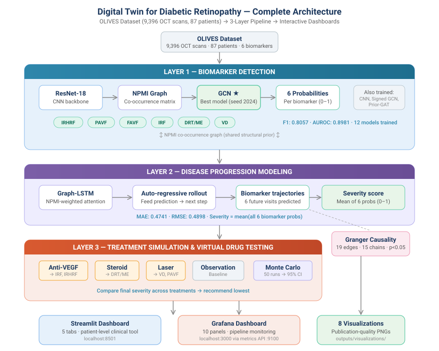
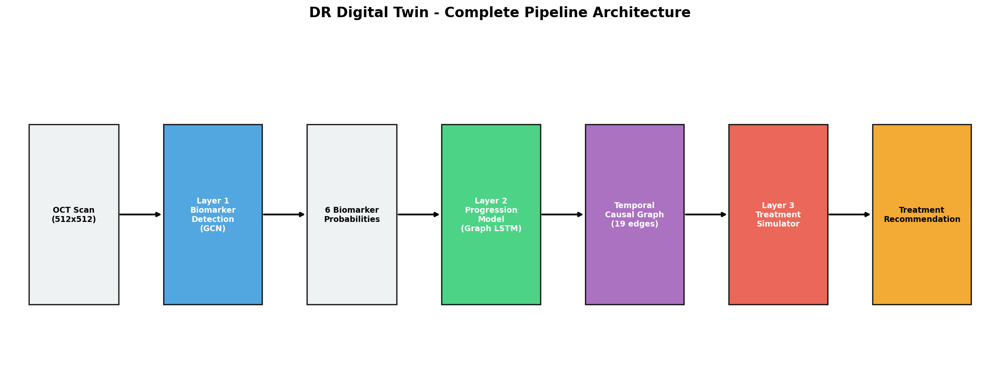
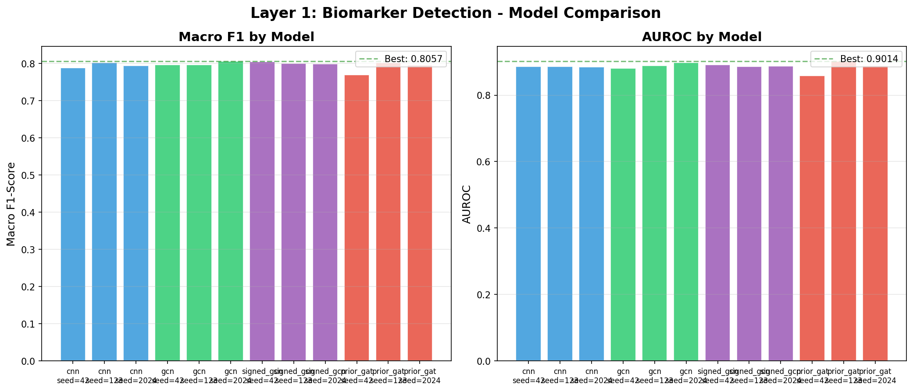
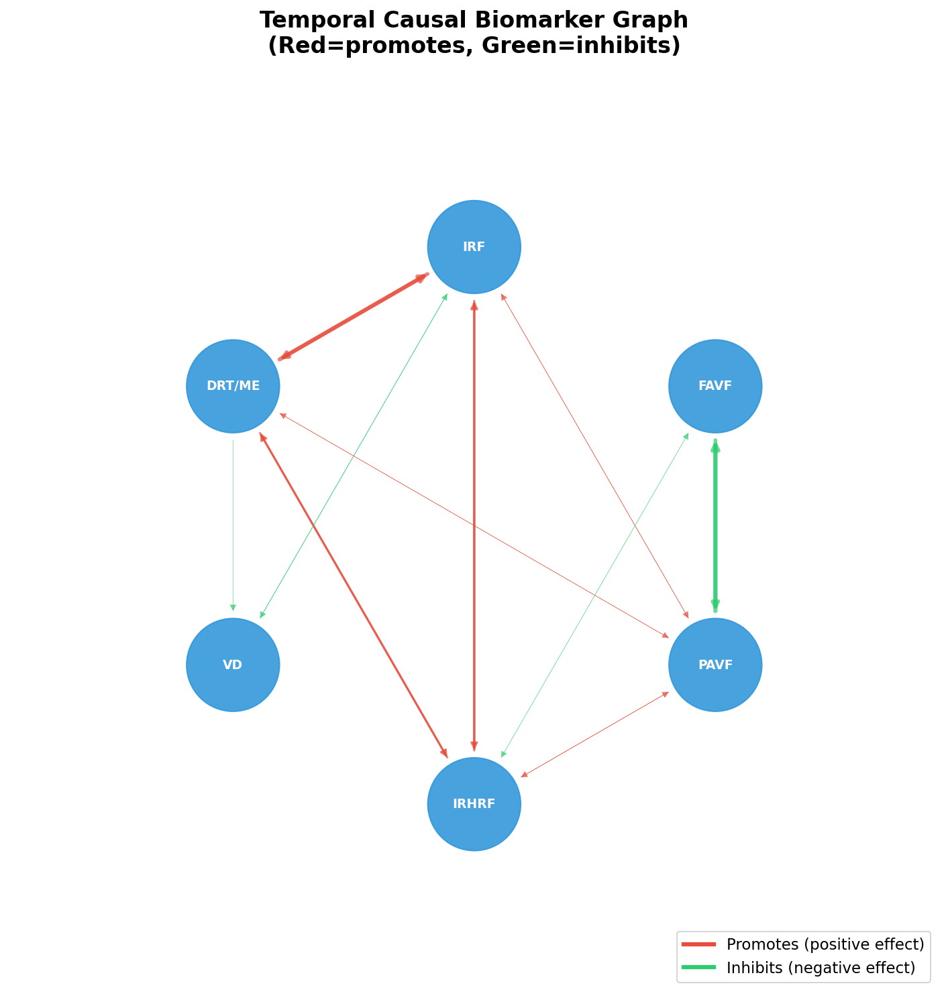
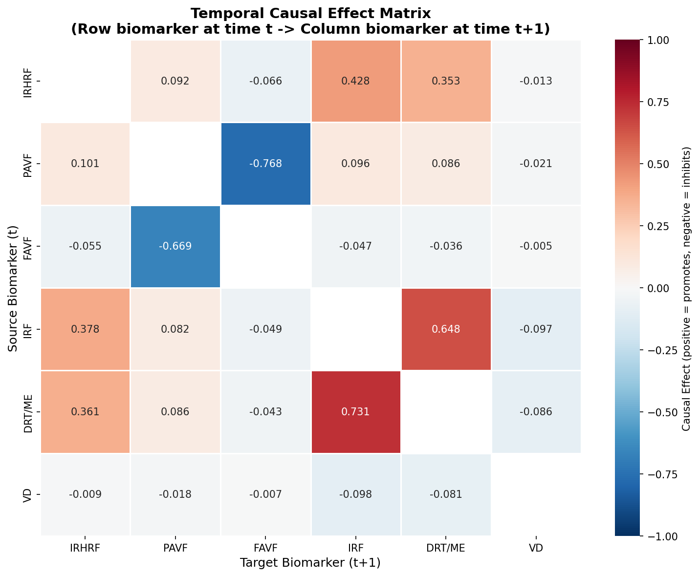
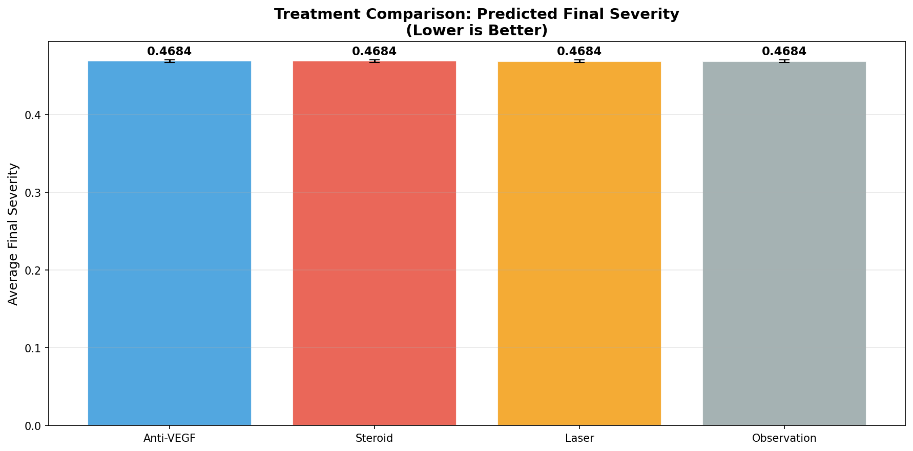

# Digital Twin for Diabetic Retinopathy
## Graph-Aware Biomarker Detection, Progression Modeling & Virtual Drug Testing

A three-layer deep learning pipeline that creates patient-specific digital twins for diabetic retinopathy (DR), enabling personalized disease progression modeling and virtual drug testing on real clinical data.

**Trained on**: OLIVES dataset (9,396 OCT scans, 87 patients, 6 retinal biomarkers)
**Hardware used**: NVIDIA RTX 5090 (32 GB VRAM), Intel Core i9 Ultra, 128 GB RAM

---

## Results (Real OLIVES Data)

| Metric | Value |
|--------|-------|
| Best Model | GCN (seed=2024) |
| Macro F1-Score | **0.8057** |
| AUROC | **0.8981** |
| Micro F1-Score | 0.8157 |
| 95% CI (F1) | [0.764, 0.840] |
| Progression MAE | 0.4741 |
| Causal Edges Discovered | 19 |
| Causal Chains | 15 |
| Test Patients Simulated | 10 |
| Models Trained | 12 (4 architectures x 3 seeds) |

### Top Causal Chains (Biomarker Cascades)
```
DRT/ME -> IRF -> IRHRF    (strength: 0.307)
PAVF   -> IRF -> IRHRF    (strength: 0.254)
VD     -> IRF -> IRHRF    (strength: 0.231)
```

---

## Architecture

<p align="center">
  
</p>

**Three-layer pipeline:**

| Layer | Component | Input | Output |
|-------|-----------|-------|--------|
| **Layer 1** | ResNet-18 → NPMI Graph → GCN | OCT scan image | 6 biomarker probabilities |
| **Layer 2** | Graph-LSTM (auto-regressive) | Biomarker state + treatment | 6 future visit trajectories + severity score |
| **Layer 3** | Treatment Simulator + Monte Carlo | 4 treatment scenarios | Best treatment recommendation + 95% CI |

**Shared structural prior:** The NPMI co-occurrence matrix connects Layers 1 and 2, ensuring biomarker predictions respect known co-occurrence patterns.

---

## Quick Start

### 1. Clone and install

```bash
git clone https://github.com/YOUR_USERNAME/DR_DigitalTwin.git
cd DR_DigitalTwin
pip install -r requirements.txt
```

### 2. Download OLIVES dataset

Download from [Kaggle OLIVES](https://www.kaggle.com/datasets/olivesdataset/olives-dataset) and place the files:

```
DR_DigitalTwin/
└── data/
    ├── labels/
    │   └── Biomarker_Clinical_Data_Images.csv
    └── OLIVES/
        ├── Prime_FULL/
        │   └── Prime_FULL/       # OCT images
        └── TREX_DME/
            └── TREX DME/         # OCT images
```

### 3. Run the full pipeline

```bash
# Full training (needs GPU, ~2 hours on RTX 5090)
python run_pipeline.py

# Or set custom paths
python run_pipeline.py --label-csv path/to/Biomarker_Clinical_Data_Images.csv
```

### 4. Launch the interactive dashboard

```bash
streamlit run ui/app.py
```

Open `http://localhost:8501` in your browser. The dashboard has 5 tabs:
- **Current State** — Patient biomarker radar chart
- **Disease Progression** — Predicted biomarker trajectories
- **Treatment Comparison** — Virtual drug testing results
- **Causal Graph** — Discovered biomarker interaction network
- **Patient Report** — Full clinical recommendation

### 5. Generate visualizations

```bash
python generate_all_visuals.py
```

Creates 8 publication-quality plots in `outputs/visualizations/`.

### 6. Launch Grafana monitoring dashboard (optional)

> **Note**: The Grafana Infinity plugin (required for JSON API panels) requires Grafana ≥ 11.6.11. If you are running an older Grafana version, use the **Streamlit dashboard** (step 4) instead — it provides the same data with full interactivity.

```bash
python metrics_server.py &            # Start metrics API on port 9100
# Requires: Grafana OSS >= 11.6.11 + Infinity plugin
# grafana-server --homepath ./grafana
# Import grafana_dashboard.json via Grafana UI
```

---

## Project Structure

```
DR_DigitalTwin/
├── config.py                          # Central configuration
├── run_pipeline.py                    # Main pipeline runner
├── generate_all_visuals.py            # Generate all result plots
├── metrics_server.py                  # JSON API for Grafana
├── requirements.txt                   # Python dependencies
│
├── layer1_biomarker/                  # Layer 1: Biomarker Detection
│   ├── models.py                      # CNN, GCN, Signed GCN, Prior-GAT
│   ├── graph.py                       # NPMI graph construction
│   └── train.py                       # Training loop with bootstrap CI
│
├── layer2_progression/                # Layer 2: Temporal Progression
│   ├── models.py                      # LSTM, Graph-LSTM
│   ├── train.py                       # Training loop
│   └── causal_graph.py               # Granger causal analysis
│
├── layer3_treatment/                  # Layer 3: Treatment Simulation
│   └── simulator.py                   # Counterfactual rollout
│
├── digital_twin/                      # Digital Twin Engine
│   └── twin.py                        # PatientDigitalTwin class
│
├── ui/                                # Interactive Dashboard
│   └── app.py                         # Streamlit 5-tab dashboard
│
├── utils/                             # Shared utilities
│   ├── data.py                        # Data loading, splitting, sequences
│   └── metrics.py                     # Evaluation metrics
│
├── grafana/                           # Grafana dashboard config
│   └── metrics_server.py              # Metrics API endpoint
│
├── outputs/                           # Pipeline outputs (after training)
│   ├── metrics/                       # JSON result files
│   │   ├── layer1_results.json        # All 12 model scores
│   │   ├── causal_analysis.json       # 19 causal edges
│   │   ├── patient_reports.json       # Treatment recommendations
│   │   ├── training_history.json      # Epoch-by-epoch loss
│   │   └── pipeline_report.json       # Summary statistics
│   └── visualizations/                # Generated plots
│       ├── 01_training_curves.png
│       ├── 02_model_comparison.png
│       ├── 03_causal_heatmap.png
│       ├── 04_causal_graph.png
│       ├── 05_causal_chains.png
│       ├── 06_patient_treatments.png
│       ├── 07_treatment_comparison.png
│       └── 08_architecture.png
│
├── DR_DigitalTwin_Project_Report.tex  # LaTeX project report
├── DR_DigitalTwin_Project_Report.pdf  # Compiled report
├── DR_DigitalTwin_Explainer.tex       # Technical explainer
└── DR_DigitalTwin_Full_Pipeline.ipynb # Kaggle notebook (self-contained)
```

---

## Models

### Layer 1: Biomarker Detection (4 architectures x 3 seeds = 12 models)

| Model | Seed | Macro F1 | AUROC | 95% CI |
|-------|------|----------|-------|--------|
| **GCN** | **2024** | **0.8057** | **0.8981** | **[0.764, 0.840]** |
| GCN | 42 | 0.7963 | 0.8925 | [0.756, 0.830] |
| GCN | 123 | 0.8014 | 0.8945 | [0.759, 0.836] |
| Signed GCN | 2024 | 0.8048 | 0.8967 | [0.762, 0.838] |
| Signed GCN | 123 | 0.8012 | 0.8942 | [0.759, 0.836] |
| Signed GCN | 42 | 0.7992 | 0.8931 | [0.757, 0.834] |
| CNN | 2024 | 0.8025 | 0.8924 | [0.761, 0.837] |
| CNN | 123 | 0.7953 | 0.8897 | [0.754, 0.830] |
| CNN | 42 | 0.7890 | 0.8867 | [0.743, 0.834] |
| Prior-GAT | 2024 | 0.8017 | 0.8939 | [0.757, 0.835] |
| Prior-GAT | 123 | 0.7878 | 0.8835 | [0.741, 0.826] |
| Prior-GAT | 42 | 0.7702 | 0.8792 | [0.724, 0.808] |

### Layer 2: Temporal Progression
- **Model**: Graph-LSTM with NPMI-weighted attention
- **MAE**: 0.4741 | **RMSE**: 0.4898

### Causal Analysis
- **Method**: Granger causality on longitudinal biomarker sequences
- **Significant edges**: 19 (p < 0.05)
- **Key finding**: DRT/ME and IRF are central hub biomarkers

---

## Dataset

**OLIVES** (Ophthalmic Labels for Investigating Visual Eye Semantics)
- 9,396 labeled OCT scans from 87 patients (96 patient-eyes)
- Two clinical trials: PRIME and TREX DME
- Six biomarkers: IRHRF, PAVF, FAVF, IRF, DRT/ME, VD
- Longitudinal visits per patient-eye

Download: [Kaggle OLIVES Dataset](https://www.kaggle.com/datasets/olivesdataset/olives-dataset)

---

## Configuration

Key settings in `config.py`:

```python
# Standard mode (laptop/desktop GPU)
IMG_SIZE = 256
BATCH_SIZE = 32
MAX_EPOCHS = 25
SEEDS = [42, 123, 2024]

# Workstation mode (auto-detected via DR_WORKSTATION=1 env var)
IMG_SIZE = 384
BATCH_SIZE = 64
MAX_EPOCHS = 40
NODE_DIM = 512
N_GNN_LAYERS = 4
```

---

## Treatments Modeled

| Treatment | Description | Effect |
|-----------|-------------|--------|
| **Anti-VEGF** | Ranibizumab, Aflibercept | Reduces IRF, IRHRF |
| **Steroid** | Intravitreal corticosteroids | Reduces DRT/ME |
| **Laser** | Photocoagulation | Reduces VD, PAVF |
| **Observation** | No active treatment | Baseline comparison |

---

## Sample Visualizations

### Architecture


### Model Comparison


### Causal Biomarker Graph


### Causal Effect Heatmap


### Treatment Comparison


---

## Windows Setup (RTX 5090 Workstation)

```bash
# Set environment variables
set DR_WORKSTATION=1
set PYTHONPATH=C:\path\to\DR_DigitalTwin

# Install PyTorch with CUDA
pip install torch torchvision --index-url https://download.pytorch.org/whl/cu128

# Install other dependencies
pip install -r requirements.txt

# Run pipeline
python run_pipeline.py
```

**Note**: On Windows with SSH, use `NUM_WORKERS=0` in config.py to avoid shared memory errors.

---

## License

MIT
